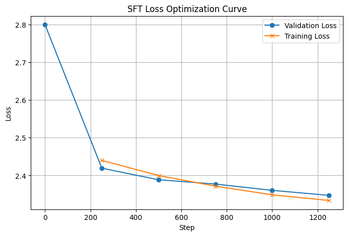
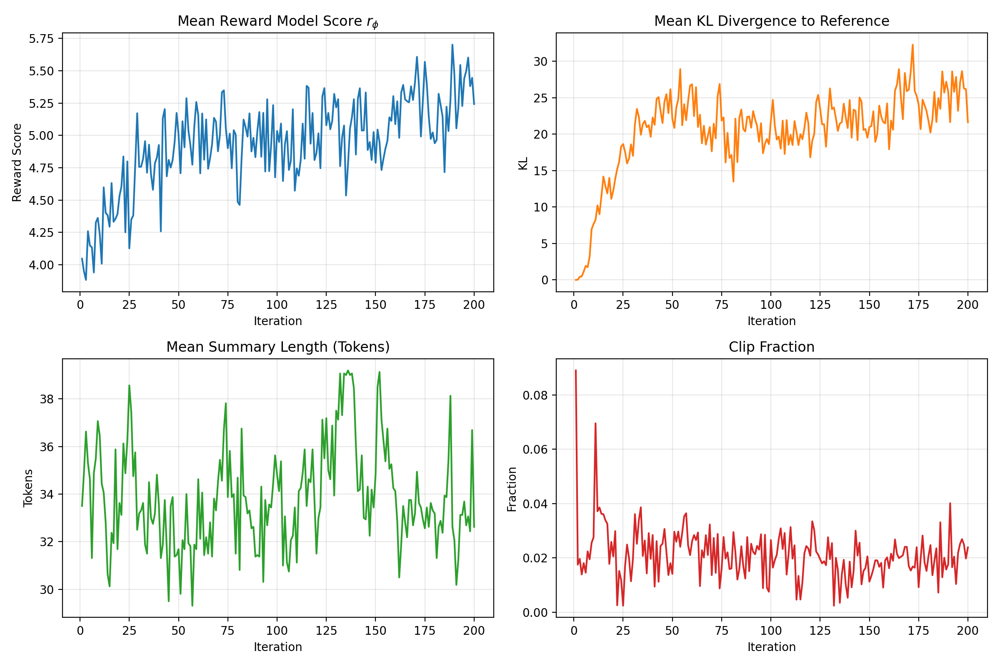
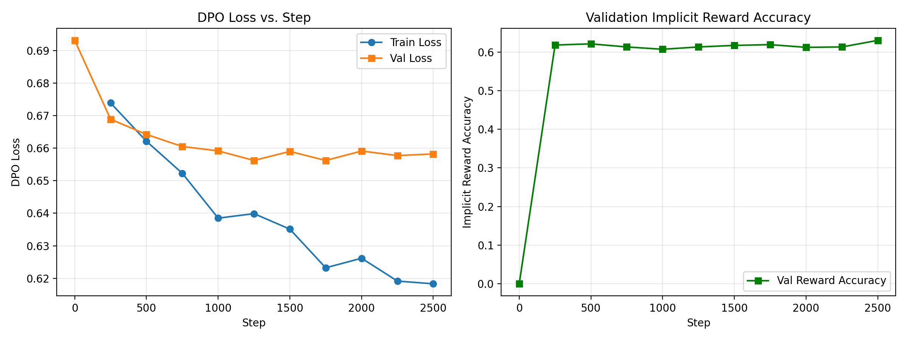

# rlhf-summarization

RLHF from scratch in PyTorch: SFT, reward model, PPO and DPO for Reddit TL;DR summarization on SmolLM2-135M.

Generative AI, Fall 2026, Assignment 03 · **Kulsoom** and **Aimen**

- Medium blog: _TODO: link_
- LinkedIn post: _TODO: link_

## Overview

A reproduction of the pipeline from *Learning to Summarize from Human Feedback* (Stiennon et al., 2020) on a 135M-parameter model, with every loss written by hand in PyTorch (no RLHF libraries):

| Stage | Model | What it learns |
|---|---|---|
| 1 | SFT policy | to write summaries, by imitating human-written ones |
| 2 | Reward model r_ϕ | to score a summary, from pairs ranked by humans (Bradley–Terry loss) |
| 3 | PPO policy | to write summaries the reward model scores highly, with a KL penalty to SFT |
| 4 | DPO policy | the same goal as PPO, directly from the ranked pairs, with no reward model |

## Checkpoints

All checkpoints are fp32 and load with `load_causal_lm(path)`; the reward model loads with `load_reward_model(path)` from `train_reward.py`.

| Model | Link |
|---|---|
| SFT | [Google Drive](https://drive.google.com/drive/folders/1fPdUNN8vwePbcgss1arjgS0-6NJQahHK) |
| Reward model | [Google Drive](https://drive.google.com/drive/folders/1Opwy1T4FSsl9dD5mqzLlnjivri_mF8x3) |
| PPO | [Google Drive](https://drive.google.com/drive/folders/1P6wgIJMGeZiAqhqFsEoO9z0QRrpqBuyf) |
| DPO | [Google Drive](https://drive.google.com/drive/folders/1pBSYecys2bxhjphYCWuVHpcopr78FL41) |

## Repository layout

```
starter/          given starter code (unchanged)
common.py         token_logprobs, summary_mask, sequence_logprobs, generation helpers
train_sft.py      Task 2: SFT
train_reward.py   Task 3: reward model class and training
train_ppo.py      Task 4: PPO
train_dpo.py      Task 5: DPO
evaluate.py       Task 6: compare SFT / PPO / DPO on 300 evaluation posts
results/          logs, tables, figures, summaries, human evaluation, analysis.md
app/              Gradio front end
```

## How to run

Everything was run on a free Colab or Kaggle T4 GPU.

```bash
pip install -r requirements.txt

# Task 1: check the starter code
cd starter && python check_starter.py && cd ..

# Stage 1: SFT  -> checkpoints/sft
python train_sft.py

# Stage 2: reward model  -> checkpoints/reward
python train_reward.py

# Stage 3: PPO  -> checkpoints/ppo
python train_ppo.py

# Stage 4: DPO  -> checkpoints/dpo
SFT_DIR=checkpoints/sft python train_dpo.py

# Task 6: evaluation on the 300 held-out posts
SFT_DIR=checkpoints/sft PPO_DIR=checkpoints/ppo DPO_DIR=checkpoints/dpo REWARD_DIR=checkpoints/reward python evaluate.py

# Front end
python app/app.py
```

Each training script has a `DEBUG` flag at the top: set it to `True` for a 10-step test run before the full run.

## Results

### Table 1: Data

| | |
|---|---|
| SFT train / validation pairs | 20,000 / 500 |
| Preference train / validation pairs | 20,000 / 1,000 |
| Evaluation posts | 300 |
| Mean / max prompt length, SFT train (tokens) | 317.42 / 448 |
| Mean / max summary length, SFT train (tokens) | 33.82 / 48 (incl. EOS) |

### Table 2: Training

| Stage | Final train loss | Validation metric | Time / GPU |
|---|---|---|---|
| SFT | 2.3338 | val. loss: 2.3473 | 61.4 min / T4 |
| Reward model | _TODO_ | pairwise acc.: _TODO_ | _TODO_ |
| PPO | policy 0.478 / value 0.254 / entropy −3.18 (iteration 200) | final mean r_ϕ: 5.24 (mean of last 10 iterations: 5.37) | 54.6 min / _TODO: GPU_ |
| DPO | 0.6183 | implicit reward acc.: 63.0% | 176.3 min / T4 |

### Table 3: Final comparison (300 evaluation posts)

| Policy | Mean r_ϕ | Win rate vs. SFT | KL to SFT | Length | ROUGE-L |
|---|---|---|---|---|---|
| SFT | 3.9029 | – | 0 | 31.75 | 0.2592 |
| PPO | 5.0531 | 87.3% | 13.7418 | 35.33 | 0.2477 |
| DPO | 4.5225 | 76.7% | 2.9443 | 38.79 | 0.2476 |

### Table 4: Human evaluation (30 posts)

| | SFT picked | PPO picked | DPO picked |
|---|---|---|---|
| Kulsoom | _TODO_ | _TODO_ | _TODO_ |
| Aimen | _TODO_ | _TODO_ | _TODO_ |
| Agreement between members | | _TODO_ / 30 | |

### Figures

| | |
|---|---|
| Figure 1: SFT training and validation loss |  |
| Figure 2: Reward-model training loss and validation accuracy | _TODO: results/fig2_reward.png_ |
| Figure 3: PPO mean r_ϕ, KL, length and clip fraction |  |
| Figure 4: DPO loss and implicit reward accuracy |  |
| Figure 5: Front end | _TODO: results/fig5_frontend.png_ |

Per-post summaries are in `results/eval_summaries.jsonl`, qualitative samples in `results/samples.md`, and the analysis in `results/analysis.md`.

## Correctness checks

**SFT mask:** decoding the tokens where `summary_mask` is 1 gives exactly the summary followed by EOS (`results/task1_checks.txt`):

```
4. decoded summary tokens match summary + EOS:
   row 0: True
   row 1: True
   row 2: True
   row 3: True

Row 0, decoded where mask = 1:
' Me and my sister were going to the park, put my sister in her carseat, left her there for thirty minutes, mom saved her from my ignorance, got grounded for a month.<|endoftext|>'
```

**Frozen models:** every parameter of π_ref and r_ϕ has `requires_grad = False`.

```
DPO:  Reference frozen: True
PPO:  TODO: paste output
```

**PPO, first iteration:** the KL to the reference is 0 (`results/ppo_log.json`, iteration 1: `"mean_kl": 0.0`).

**PPO, every iteration:** in the first of the K epochs, r_t(θ) = 1 and the clip fraction is 0.

```
TODO: paste output
```

**DPO, first step:** the loss equals log 2.

```
Step 0 | Val Loss: 0.6931 | Val Acc: 0.0000
Step 1 DPO check | Loss: 0.6931
```

**Padding:** prompts for `generate` are left-padded (`collate_prompts`). Every mask is built from `attention_mask`, never from `input_ids != pad_token_id`, because the pad token is the EOS token. The reward model reads the hidden state of the last real token, `attention_mask.sum(1) - 1`.

## Implementation notes

- **fp32, not bf16.** The current transformers version loads SmolLM2 in bfloat16. At our learning rates (5e-5 down to 2e-6), bf16 rounds most weight updates away, so every stage calls `.float()` after loading. Our first SFT run trained in bf16 and reached a validation loss of 2.44; the fp32 run reached 2.35 and was faster on the T4 (61 vs 73 min).
- **Gradient accumulation.** The required batch sizes do not fit on a T4 in fp32, so each batch is split into micro-batches. Each micro-batch's summed loss is divided by the token count (SFT) or pair count (DPO) of the full batch, so the gradients equal those of the full batch.
- **Reproducibility.** A fixed seed and a seeded DataLoader generator make runs repeatable: two DPO runs produced identical logs.

## Front end

`app/app.py` is a Gradio app: paste a Reddit post and see the SFT, PPO and DPO summaries side by side, each with its reward-model score. It loads all four checkpoints from `checkpoints/` (or from the paths in `SFT_DIR`, `PPO_DIR`, `DPO_DIR` and `REWARD_DIR`).

_TODO: screenshot (results/fig5_frontend.png)_